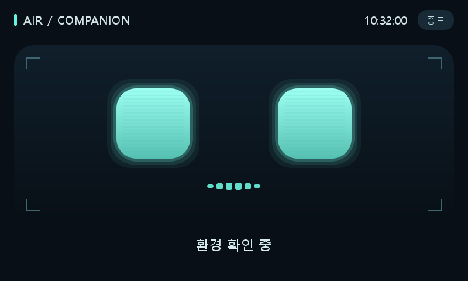
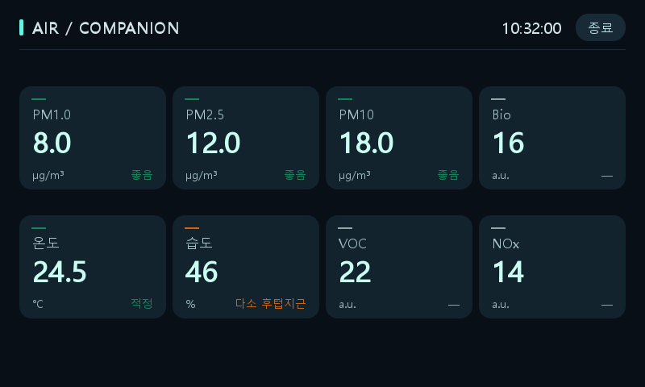

# Air Quality Robot Display — V2 UI Animation

800×480 터치 디스플레이에서 주변 공기질을 로봇의 표정과 8개 센서 카드로 보여주는 Python/Qt 프로젝트입니다. 센서값을 그대로 나열하는 대신 수집·검증·분석 과정을 거쳐 사용자가 직관적으로 이해할 수 있는 상태로 표현합니다.

실제 센서 프로토콜과 장비 설정은 공개 코드에서 분리했습니다. `moving`과 `purifying`은 UI 상태 표현이며 실제 로봇 이동이나 공기청정 장비를 제어하지 않습니다.

## 실행 화면

| 로봇 상태 화면 | 센서 상세 화면 |
|---|---|
|  |  |

### 실물 디스플레이 시연

실제 800×480 디스플레이에서 환경 확인, 정상 및 주의 상태, 공기 정화 표시 등 V2 얼굴 애니메이션의 전환을 확인한 영상입니다.

[](https://youtu.be/4nnU9S3Hfzo)

> 환경 확인 → 상태 판단 → 표정 및 안내 전환

이미지를 클릭하면 YouTube 시연 영상으로 이동합니다.

## 핵심 성과

- QPainter 기반 7가지 로봇 상태와 프레임 애니메이션 구현
- PM1.0, PM2.5, PM10, VOC, NOx, Bioaerosol, 온도, 습도 표시
- 최근 30초 이동평균과 확인 시간을 적용해 일시적인 측정값 변화에 따른 상태 흔들림 완화
- PM 급상승, 부분 센서 오류, 전체 통신 단절과 재연결 처리
- 홈·센서 상세 화면의 터치 전환과 자동 복귀 구현
- Raspberry Pi 서비스 watchdog 및 중복 실행 방지 적용
- 공개 테스트 127개 통과, 실제 Pi에서 약 6시간 PID 유지 확인
- 센서 모듈 분리·재연결 5회와 강제 종료 후 서비스 자동 재시작 확인

## 주요 기능

### 공기질 분석

- PM 3종과 온습도는 항목별 최근 30초 이동평균과 최소 표본 수를 사용합니다.
- PM 급상승은 최근 5회 중 4회와 3초 지속 조건으로 빠르게 악화를 반영합니다.
- 일부 센서값이 무효여도 정상 항목의 분석을 계속하고, 데이터가 충분할 때만 상태 개선을 확정합니다.
- VOC, NOx, Bioaerosol은 상세 카드에 표시하지만 종합 표정 판정에서는 제외합니다.
- 이 화면은 공식 AQI 또는 건강 안전 판정이 아닙니다. 세부 기준은 [SENSOR_CRITERIA.md](SENSOR_CRITERIA.md)를 참고하세요.

### UI와 상태 애니메이션

| 상태 | 화면 동작 |
|---|---|
| `waiting` | 입 파형이 오른쪽으로 흐름 |
| `monitoring` | 눈이 좌우로 주변을 탐색 |
| `normal` | 일정 간격으로 눈을 깜빡임 |
| `detected` | 느낌표가 점멸 |
| `comfortable` | 눈이 위아래로 미세하게 이동 |
| `moving` | 방향 화살표와 시선이 좌우로 전환 |
| `purifying` | 공기 물결과 입 파형이 움직임 |

`robot_animation.py`는 경과시간에 따른 애니메이션 상태를 계산하고, `robot_ui.py`는 하나의 75ms Qt 타이머로 화면을 다시 그립니다. 얼굴 화면이 숨겨지면 타이머도 정지합니다.

### 통신 오류와 복구

- 짧은 수신 오류에는 마지막 정상값과 확정 표정을 유지합니다.
- 개별 센서가 5초 이상 무효이면 해당 센서만 다시 수집합니다.
- 장시간 수신이 중단되면 센서 상세 화면에서 홈 화면으로 복귀합니다.
- 재연결 시 단절 이전 표본을 버리고 새 표본으로 빠른 재판정을 수행한 뒤 일반 30초 분석으로 돌아갑니다.
- Linux에서는 센서 모듈에 사용하는 `/dev/ttyUSB*`, `/dev/ttyACM*`만 자동 탐색합니다.

## 동작 구조

```text
센서 모듈
   ↓ Serial
수신·프레임 검증
   ↓
항목별 유효성 검사 및 이동평균
   ↓
환경 상태 확정
   ↓
로봇 얼굴 애니메이션 / 8개 센서 카드
```

주요 구성과 수정 위치는 [코드 구조 문서](docs/ARCHITECTURE.md), 인계 및 실행 조건은 [인수인계 안내](docs/HANDOVER.md)를 참고하세요.

## 기술 스택

- Python
- PySide6 — Windows 개발 환경
- PySide2 / Qt 5 — 기존 Raspberry Pi 환경
- QPainter
- pySerial
- unittest

## 빠른 실행

센서 프로토콜이 없는 공개본은 데모 모드로 실행합니다.

```powershell
python -m venv .venv
.\.venv\Scripts\python.exe -m pip install -r requirements.txt
.\.venv\Scripts\python.exe main.py --demo --windowed
```

7개 얼굴 상태와 애니메이션을 순서대로 확인하려면 다음 명령을 사용합니다.

```powershell
.\.venv\Scripts\python.exe main.py --demo-states --windowed
```

통신 오류와 복구를 포함한 전체 시나리오는 통합 데모로 확인할 수 있습니다.

```powershell
.\.venv\Scripts\python.exe main.py --demo-tour --windowed
```

Raspberry Pi/Linux에서는 `python3 main.py --demo-states --windowed` 형식으로 실행합니다. 전체화면에서는 `--windowed`를 생략합니다.

## 테스트

테스트는 가짜 포트·데이터와 offscreen Qt를 사용하므로 센서 없이 실행할 수 있습니다.

```powershell
.\.venv\Scripts\python.exe -m unittest discover -s tests -p "test_*.py"
.\.venv\Scripts\python.exe tests\check_demo.py
```

`tests/check_demo.py`는 `previews/images/`에 런타임 UI 미리보기를 생성합니다. 실제 Pi 렌더링, 장시간 운용, 장비 전용 패킷은 별도 검증 범위입니다.

## 비공개 센서 프로토콜

공개 저장소에는 실제 register 주소, 장치 ID, 요청·응답 프레임, 센서값 매핑 및 시리얼 설정을 포함하지 않습니다.

- `sensor_protocol_template.py`: 공개용 함수·예외 인터페이스
- `sensor_connection_example.py`: 공개용 연결 설정 예시
- `sensor_protocol.py`: 승인된 실제 구현을 두는 로컬 전용 파일
- `sensor_connection_local.py`: 실제 장비 연결값을 두는 로컬 전용 파일

템플릿은 애플리케이션 구조와 확장 지점을 보여주기 위한 것으로, placeholder만 채워 실제 프로토콜이 완성되는 형태가 아닙니다. 장비 파일은 Git 추적에서 제외합니다.

## 문서

- [인수인계 안내](docs/HANDOVER.md)
- [코드 구조와 수정 위치](docs/ARCHITECTURE.md)
- [센서 판정 기준](SENSOR_CRITERIA.md)
- [전체 개발·검증 기록](PROJECT_HISTORY.md)
- [익명화된 Raspberry Pi 시험 로그](logs/)

## 프로젝트 상태

2026-10-12 협업 기업에 당시까지의 작업물을 인계하고 Raspberry Pi 측 추가 업데이트를 종료했습니다. 현재 저장소는 인계 시점의 공개 가능한 UI·분석·복구 코드와 검증 자료를 보존합니다.

실제 센서 모듈의 제조사 측정 범위와 프로토콜, Pi 환경의 폰트·터치·장시간 애니메이션 성능은 장비에서 추가 확인해야 합니다. 외부 이동·정화 통신 규격과 실제 장비 제어는 구현 범위에 포함하지 않았습니다.
